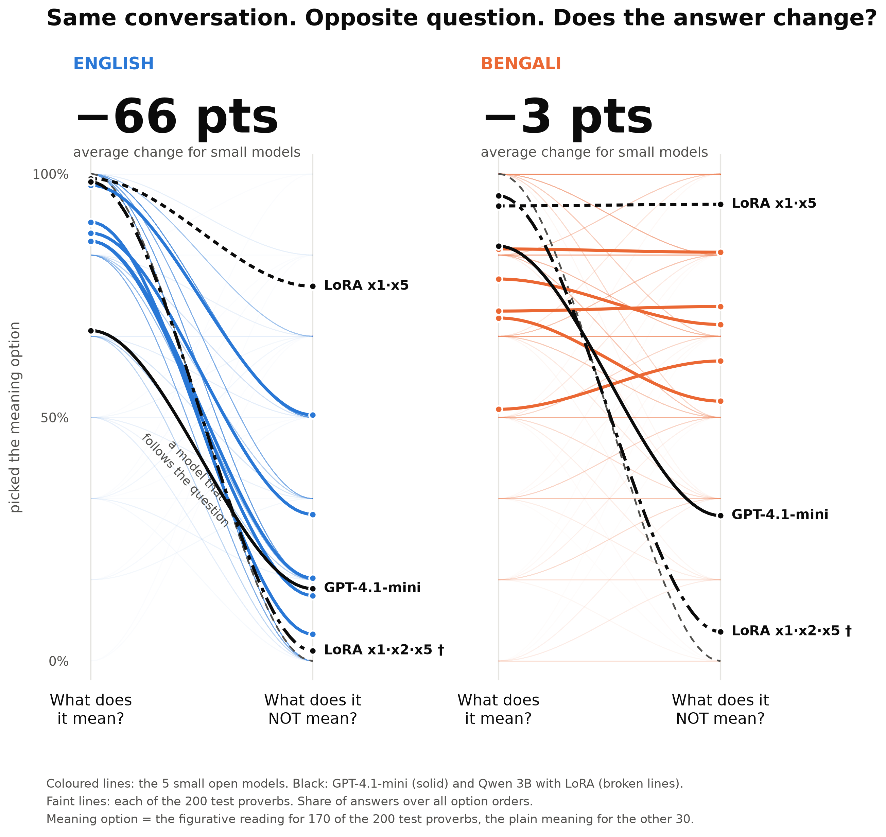

# Knowing Culture ≠ Using It

**Do small language models understand Bengali proverbs in conversation, or does it only look like they do?**

Code, data and notebooks for our MTech project (CS6803-TNLP-2026, IIT Hyderabad).
Anik Mallick · Prof. Maunendra D



## In short

- We built **ProBaD**: 200 Bengali proverbs, each used in **3 short conversations**, and every conversation written in **parallel Bengali and English** (600 test items). Another 125 proverbs (300 + 75 items) are kept separate for fine-tuning.
- A model must say what the speaker means. The options are the **meaning** (right), a **literal reading** of the proverb's words, and a **believable** wrong answer.
- Small models (0.5B–7B) usually pick the meaning. But when we ask the **opposite question** ("what does the speaker NOT mean?"), they give the **same answer in Bengali**, while in English they switch, as they should. In Bengali they are insensitive to the polarity of the question. That shows a behaviour, not a direct measure of cultural knowledge.
- Bigger models close the Bengali gap on meaning questions, but not on the opposite question. Persona prompts barely help.
- **Fine-tuning teaches the rule its training questions reward.** Trained on meaning questions only, Qwen2.5-3B learns "never pick the literal option" (opposite question, Bengali: 40% → 6%). With the opposite question added to training, it learns to follow the question, even in a wording it never saw (94%). But it still rarely says "none of these" when the right answer is missing, and it leans on a wording cue in the distractors. (One run per training mix, so this is a preliminary result.)

**Take-away: picking the meaning is not proof of understanding. Ask the opposite question too.**

## Key numbers

Question sensitivity = accuracy on "what does it mean?" + accuracy on "what does it NOT mean?" − 1.
1 = the answer flips with the question; 0 = the same answer either way.

| Model | English | Bengali |
|---|---|---|
| Untuned small models (BLOOMZ-7B1, Qwen2.5 0.5B–7B) | 0.47 – 0.85 | −0.10 – 0.17 |
| GPT-4.1-mini | 0.53 | 0.55 |
| Qwen2.5-3B + LoRA, trained on x1 + x5 | 0.22 | 0.00 |
| Qwen2.5-3B + LoRA, trained on x1 + x2 + x5 (held-out wording) | 0.97 | 0.89 |

## The data

| | Test | Train | Validation |
|---|---|---|---|
| Proverbs (and idioms) | 200 | 100 | 25 |
| Figurative / non-figurative | 170 / 30 | 97 / 3 | 24 / 1 |
| Items (one conversation, in two languages) | 600 | 300 | 75 |
| Also in MAPS Bengali: proverbs | 37 | 8 | 6 |

Each item has: the proverb (Bengali script, romanised, word-for-word gloss, meaning in English and Bengali, figurative or not, region, cultural note), one conversation in English and in Bengali, three options per language, and a memorisation probe (the proverb without its last word). Splits are by proverb, and proverbs with the same meaning stay in the same split.

**How it was made.** An LLM (Claude Opus 5.5) drafted every item from our writing rules. A script checked the format (0 errors on all 975 items), and GPT-6.2 validated every item on 9 checks. **Native-speaker review is still to do**, so please treat the data as a careful draft. Every item is labelled `"author": "claude (draft, needs native-speaker check)"`. Validator records are included.

**Known issues.** Most items were flagged "needs revision" by the validator, mostly for romanisation and wording. In some items the setup gives the meaning away. Many believable distractors say what someone "thinks", which fine-tuned models learn to avoid.

## The tests

Every item is asked in several ways, in both languages and in every option order.

| Test | What we ask | A model that understands… |
|---|---|---|
| x1 | What does the speaker mean? (meaning vs literal) | picks the meaning |
| x2 | What does the speaker NOT mean? (same options) | picks the literal option |
| x2r | x2 in a new wording (used only in the fine-tuning study) | picks the literal option |
| x3 | Meaning option removed, "none of these" added | picks "none of these" |
| x4 | What does the proverb mean? (no conversation) | knows the meaning |
| x5 | Three options: meaning, literal, believable distractor | picks the meaning |
| x6 | Proverb written 4 ways (romanised, Bengali script, + gloss, gloss only) | is not thrown by the spelling |
| x7 | Conversation and options, but no question | (control) |
| x8 | x1 with a persona system prompt (short or rich, English or Bengali) | uses the cultural framing |

We also re-ran the MAPS tests (E1–E9, Liu et al., 2024) on our data with OLMo-2-1B, Gemma-3-1B and BLOOMZ-7B1.

**Scoring.** The prompt ends with `Answer:` (or `উত্তর:`). We read the model's next-token probability for `A`, `B`, `C`, renormalise over the letters shown, and take the most likely one. There is no text generation. For chat models, the chat template is applied and the answer cue is repeated at the start of the reply. Accuracy is averaged over option orders, and 95% intervals come from 2,000 bootstrap resamples of whole proverbs. GPT-4.1-mini is scored from the API's top-20 log-probs of the first reply token, with the system message "Reply with only the letter of your answer.", in one option order.

The tests measure three different abilities: **interpretation** (x1, x4, x5), **question sensitivity** (x1 vs x2) and **option rejection** (x3). A model can have one without the others.

## Models

| Model | Version | Precision |
|---|---|---|
| OLMo-2 1B (base) | `allenai/OLMo-2-0425-1B` | FP16 |
| Gemma-3 1B | `google/gemma-3-1b-it` | FP16 |
| BLOOMZ 7.1B | `bigscience/bloomz-7b1-mt` | 4-bit |
| Qwen2.5 0.5B · 1.5B · 3B · 7B | `Qwen/Qwen2.5-{0.5B,1.5B,3B,7B}-Instruct` | FP32 · FP32 · FP16 · 4-bit |
| Qwen2.5-3B + LoRA (two runs) | our adapters | 4-bit NF4 |
| GPT-4.1-mini | `gpt-4.1-mini` (OpenAI API) | top-20 log-probs |

**LoRA settings (both runs).** QLoRA on Qwen2.5-3B-Instruct (4-bit NF4); rank 16, alpha 32, dropout 0.05 on q, k, v, o, gate, up and down projections; 3 epochs; paged 8-bit AdamW, learning rate 2e-4 (cosine, 10 warm-up steps), weight decay 0.01; effective batch 16; fp16 with gradient checkpointing; max length 512; loss on the answer letter only; best checkpoint by validation loss; seed 0. Run 1 trains on x1 + x5 (3,000 prompts), run 2 on x1 + x2 + x5 (4,200 prompts).

## Repository layout

```
probad/                 the Python package
  schema.py             item model + validation (format checks, word-overlap and leak checks)
  builder.py            item -> prompts (language × spelling × format × option order)
  constants.py          fixed question text (EN/BN), option keys, persona prompts
  scoring.py            load a model, letter log-probs per prompt
  metrics.py            collapse option orders, accuracy + bootstrap CI, paired comparison
  utils.py              JSONL, text normalisation, stopwords
experiments.py          MAPS-style experiments E1–E9
maps_builder.py         MAPS-exact prompt patterns
data/
  test.jsonl, train.jsonl, val.jsonl     the items
  proverbs_v1.csv                        the proverb list with all labels and the split
  romanisation_v1.md                     romanisation rules
  validation/                            GPT-6.2 validator record for every item
notebooks/              runs, LoRA training and evaluation, GPT reference, analysis and charts
```

Main notebooks:

| Notebook | What it does |
|---|---|
| x-tests runner | runs x1–x8 for one open model, writes `raw/*.csv` |
| GPT reference | runs x1–x8 for GPT-4.1-mini through the API |
| MAPS-style | runs E1–E9 |
| LoRA training | builds the training prompts and trains the adapter |
| LoRA evaluation | scores the 4-bit base and the adapter (core tests + x2r) |
| validation | GPT-6.2 validation and its charts |
| `probad_cross_model_v2.ipynb` | collects every run and draws all cross-model and write-up charts |

## Quick start

```bash
git clone https://github.com/AnikMallick/bn-proverbs-in-context.git
cd bn-proverbs-in-context
pip install -e .            # on Kaggle: pip install stopwordsiso (the rest is pre-installed)
```

```python
from probad.schema import TestItem, validate_items
items = list(TestItem.load_items("data/test.jsonl"))
print(len(items), "items;", len(validate_items(items, [])), "issues")
```

All results in the write-up were produced on free Kaggle T4 GPUs. Run every condition for one model on the same machine.

## Intended use and limits

For research on how language models are evaluated. It is not a measure of anyone's Bengali, and a high score does not mean a model "understands Bengali culture". The items were written by an LLM, the proverb list has not been checked against a published collection, and the test is multiple choice only. Please read the limitations in the write-up before building on the data.

## Use of AI tools

Claude (Anthropic) drafted the data items. GPT-6.2 (OpenAI) validated them, and GPT-4.1-mini was a test subject. AI assistants helped with code, charts and writing. The authors ran all experiments and are responsible for the content.

## Licence

Code and LoRA adapters: MIT. Data: CC BY 4.0. MAPS data and the Bengali stopword list keep their own licences.

## Citation

```bibtex
@misc{mallick2026knowingculture,
  title  = {Knowing Culture {\ne} Using It: Cultural Alignment of Small Language Models
            for Contextual Understanding of Bengali Proverbs},
  author = {Mallick, Anik and D, Maunendra},
  year   = {2026},
  note   = {MTech project, CS6803-TNLP-2026, IIT Hyderabad},
  url    = {https://github.com/AnikMallick/bn-proverbs-in-context}
}
```

## Acknowledgements

Our test design builds on MAPS: Liu, Koto, Baldwin and Gurevych (2024), *Are Multilingual LLMs Culturally-Diverse Reasoners? An Investigation into Multicultural Proverbs and Sayings*, NAACL 2024.